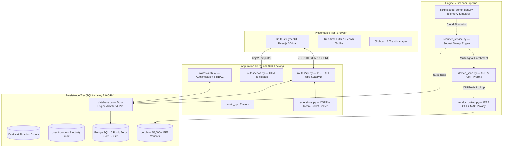

# PortWatch

<div align="center">

**Real-Time Wi-Fi Subnet & Mobile Hotspot Reconnaissance Station**

[](https://www.python.org/)
[](https://flask.palletsprojects.com/)
[](https://www.sqlalchemy.org/)
[](https://www.postgresql.org/)
[](https://www.docker.com/)
[](LICENSE)
[]()

*A full-stack network monitoring dashboard and telemetry engine designed to detect, fingerprint, and visualize connected client devices on Wi-Fi subnets and mobile hotspots in real time.*

[Features](#-key-features) •
[Architecture](#-system-architecture) •
[Quickstart](#-quickstart) •
[Docker](#-docker-deployment) •
[Cloud Deployment](#-cloud-deployment-vercel--supabase) •
[API Reference](#-rest-api-reference) •
[Testing](#-test-suite)

</div>

---

## 📌 Executive Summary

Modern mobile operating systems (iOS and Android) provide native personal hotspot capabilities, but provide virtually **zero visibility** into what devices are actively connected, their bandwidth usage, their physical proximity, or their hardware origins.

**PortWatch** addresses this visibility gap. Running as an unprivileged client on a workstation joined to the hotspot or LAN, PortWatch combines passive ARP cache inspection, multi-threaded ICMP echo sweeps, socket-level service fingerprinting, and a local 58,000+ IEEE OUI database to reconstruct an accurate inventory of connected nodes.

Built as a senior Computer Science capstone project, PortWatch demonstrates production-grade full-stack engineering: an **application factory architecture**, **SQLAlchemy 2.0 dual-engine persistence (SQLite / PostgreSQL)**, **OWASP-aligned security hardening**, a **brutalist cyber-hardware UI**, and **one-click cloud deployment with live demonstration capabilities**.

---

## ⚡ Key Features

- **Layer 2/3 Network Discovery**:
  - Automatically identifies local default gateways and resolves `/24` hotspot subnets (`192.168.137.0/24`, `192.168.43.0/24`, `172.20.10.0/24`).
  - ThreadPool-driven parallel ping sweeps with power-save wakeups to reliably probe sleeping mobile clients.
  - ARP table delta tracking that preserves disconnected devices as offline nodes with exact "last seen" timestamps.

- **Multi-Signal Hardware Fingerprinting**:
  - **Local IEEE OUI Database**: Bundled offline SQLite database with **58,000+ hardware vendor entries** for zero-latency, rate-limit-free manufacturer resolution.
  - **MAC Privacy Awareness**: Automatically detects IEEE 802 Locally Administered Bits (LABs) to classify private/randomized MAC addresses used by modern Android 10+ and iOS 14+ devices.
  - **TTL Hop Classification**: Evaluates IP Time-To-Live (TTL) baselines (64 for iOS/Linux/Android, 128 for Windows, 255 for network gear) to detect tethering and downstream network bridges.
  - **Mobile Service Signatures**: Non-invasive socket probes for Apple MobileDevice (`lockdownd`), Google Cast (`8008/8009`), and Android ADB (`5555`).

- **RF Propagation & Link Estimation**:
  - Direct Wi-Fi telemetry integration via native OS interfaces (`netsh wlan show interfaces`).
  - Distance estimation using standard log-distance path-loss models based on measured round-trip time (RTT).
  - Bandwidth throughput grading based on dynamic latency jitter analysis.

- **Security & Multi-Tenancy**:
  - Multi-user authentication with isolated tenant workspaces.
  - Strict CSRF token validation on state-changing requests (`Flask-WTF`).
  - Defense against timing side-channels via dummy password hash evaluation on non-existent users.
  - Exponential brute-force lockout policy (locks account for 15 minutes after 5 failed attempts).
  - Production security headers: Content-Security-Policy (CSP), Strict-Transport-Security (HSTS), `X-Frame-Options: SAMEORIGIN`, `X-Content-Type-Options: nosniff`.

- **Brutalist Cyber-Hardware Interface**:
  - Flipper Zero / Wireshark-inspired brutalist tactile UI with instant light/dark mode switching.
  - Real-time client-side filter toolbar (live search, category tabs: All, Online, Offline, Phones, Laptops, IoT).
  - Click-to-copy utility for MAC and IP addresses with instant toast feedback.
  - Interactive Three.js 3D network topology map visualizing client hop relationships and signal radii.

- **Dual-Mode Cloud Deployment**:
  - **Local Hardware Mode**: Real-time passive/active network probing on physical network adapters.
  - **Cloud Showcase Mode**: Automatic serverless simulation mode (Vercel / Render / Railway) that generates dynamic, realistic client telemetry with live jitter for technical recruiter evaluations without physical hardware dependencies.

---

## 🏛 System Architecture



---

## 🚀 Quickstart

### Prerequisites
- Python 3.10, 3.11, or 3.12
- Windows, Linux, or macOS workstation

### 1. Clone & Set Up Virtual Environment

```bash
git clone https://github.com/your-username/portwatch.git
cd portwatch

# Create and activate virtual environment
python -m venv venv
# Windows:
.\venv\Scripts\activate
# Linux/macOS:
source venv/bin/activate

# Install dependencies
python -m pip install --upgrade pip
python -m pip install -r requirements.txt
```

### 2. Configure Environment

Copy the template configuration file:
```bash
cp .env.example .env
```
*(Default settings automatically run in local zero-configuration SQLite mode).*

### 3. Launch PortWatch

```bash
python app.py
```
Open **[http://localhost:5000](http://localhost:5000)** in your browser.

- Sign up for a personal account, or use the preconfigured demonstration credentials:
  - **Username**: `demo`
  - **Password**: `DemoAdmin123!`

---

## 🐳 Docker Deployment

PortWatch includes a production-ready, security-hardened `Dockerfile` and `docker-compose.yml` bundling a dedicated PostgreSQL 16 database.

### Start the Full-Stack Application:
```bash
docker compose up -d --build
```

### Check Service Health:
```bash
docker compose ps
```
The application will automatically wait for PostgreSQL to become healthy, run database migrations, and expose the web dashboard on port `5000`.

### Stop Services:
```bash
docker compose down
```

---

## ☁ Cloud Deployment (Vercel & Supabase)

PortWatch is architected to run seamlessly on modern serverless cloud infrastructure:

### 1. Database Setup (Supabase or Neon)
1. Create a free PostgreSQL database on [Supabase](https://supabase.com/) or [Neon](https://neon.tech/).
2. Copy your pooled connection URI:
   ```
   postgresql://postgres:[PASSWORD]@[HOST]:5432/postgres
   ```

### 2. Deploying to Vercel
1. Fork or push this repository to your GitHub account.
2. Import the repository into [Vercel](https://vercel.com/).
3. In Project Settings → Environment Variables, add:
   - `DATABASE_URL`: Your Supabase/Neon PostgreSQL connection URI.
   - `PORTWATCH_SECRET_KEY`: A random 64-character secret key.
   - `PORTWATCH_DEMO_MODE`: `true` (enables dynamic cloud showcase telemetry).
   - `PORTWATCH_ENV`: `production`
4. Click **Deploy**. Vercel will automatically build the serverless WSGI bridge (`api/index.py`) using `vercel.json`.

---

## 📡 REST API Reference

PortWatch provides versioned RESTful APIs mounted concurrently at `/api/` and `/api/v1/`.

| Method | Endpoint | Description | Auth Required |
|:-------|:---------|:------------|:-------------:|
| `GET` | `/api/v1/health` | System and database connection pool health check | No |
| `GET` | `/api/v1/status` | Current subnet discovery and background sweep state | Yes |
| `GET` | `/api/v1/devices` | Full inventory of discovered network devices | Yes |
| `GET` | `/api/v1/devices/<mac>/timeline` | Lifecycle history and connect/disconnect events | Yes |
| `POST` | `/api/v1/devices/<mac>/deep-scan` | On-demand service port scan and OS fingerprinting | Yes |
| `POST` | `/api/v1/devices/lookup` | Hardware MAC / vendor resolution and locator | Yes |
| `POST` | `/api/v1/devices/<mac>/forget` | Delete persistent history for a device | Yes |
| `POST` | `/api/v1/rescan` | Trigger an immediate asynchronous subnet sweep | Yes |
| `GET` | `/api/v1/user/me` | Current authenticated user session parameters | Yes |
| `GET` | `/api/v1/export/csv` | Download complete network audit report (CSV) | Yes |
| `GET` | `/api/v1/export/json` | Download complete network audit report (JSON) | Yes |

---

## 🧪 Test Suite

The test suite covers unit tests, security edge cases, database models, UI components, and cloud deployment entrypoints:

```bash
# Run all automated tests
python -m unittest discover tests -v

# Run Flake8 linter
flake8 .
```

Continuous Integration is preconfigured via GitHub Actions (`.github/workflows/ci.yml`), testing every commit against Python 3.10, 3.11, and 3.12.

---

## 🛡 Ethical Security & Transparency Notice

PortWatch is strictly designed for **authorized personal network monitoring, mobile hotspot management, and network diagnostics**:
- **Zero Raw Sniffing**: Does not place wireless interfaces into 802.11 monitor mode or capture third-party data frames.
- **Zero Cryptographic Attacks**: Does not perform WPA handshake capture or decryption.
- **Zero Cache Poisoning**: Does not generate spoofed ARP responses or manipulate network routing.
- All hardware resolution is conducted using standard OS sockets, local ARP caches, and public IEEE registry assignments.

---

## 📄 License

This project is licensed under the MIT License — see the [LICENSE](LICENSE) file for details.
